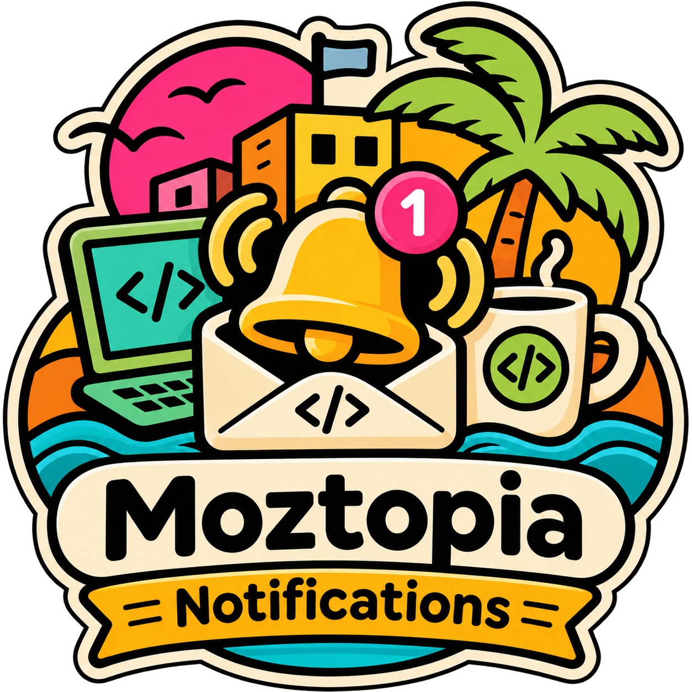

<p align="center"></p>

# Moztopia Notifications

Laravel notification history and independently queued push delivery through FCM for Android and direct APNs for iOS. One notification per recipient, one delivery per device, one retry lifecycle per delivery.

This working branch extends Whisper with [category push preferences and Android channel mapping](docs/CATEGORY_PUSH.md). It is not a new published release; the wiki and numeric 0.9.0 release describe the original contract.

**[Full implementation documentation → GitHub wiki](https://github.com/moztopia/moztopia-notifications/wiki)** · [Changelog](CHANGELOG.md) · [Release notes](https://github.com/moztopia/moztopia-notifications/releases) · [Real-device smoke tests](https://github.com/moztopia/moztopia-notifications/wiki/Testing)

## Requirements

Laravel 12 or 13; PHP 8.4.27+ or 8.5.12+; UUID recipient models; a transactional database; and a Laravel queue worker and scheduler. Runtime requirements also include the extensions required by the FCM/APNs dependencies. SQLite concurrency is covered by automated tests; see the wiki for database validation limits.

## Install

Install the published package from public Packagist:

```sh
composer require moztopia/notifications:^0.9
php artisan vendor:publish --tag=moztopia-notifications-config
php artisan vendor:publish --tag=moztopia-notifications-migrations
php artisan migrate
```

No private GitHub credentials or custom Composer repository are required for published releases. Laravel discovers the service provider automatically. The initial migration creates all five package tables, including `moztopia_notification_history`; it does not use or modify an application's `notifications` table. This branch also includes an additive preference migration; follow its [branch installation and upgrade instructions](docs/CATEGORY_PUSH.md) when using it instead of the published release. See the [installation guide](https://github.com/moztopia/moztopia-notifications/wiki/Installation) and [upgrade notes](CHANGELOG.md#upgrade-from-002).

Set `NOTIFICATIONS_APPLICATION` to a stable application identifier and `NOTIFICATIONS_FINGERPRINT_KEY` to an independently generated secret of at least 32 bytes. Tokens and internal payloads use Laravel encryption and `APP_KEY`. Configure FCM using `FIREBASE_CREDENTIALS` and the selected Firebase project; configure APNs with `APN_KEY_ID`, `APN_TEAM_ID`, `APN_BUNDLE_ID`, and `APN_PRIVATE_KEY_PATH`. [Credential and environment setup](https://github.com/moztopia/moztopia-notifications/wiki/Configuration).

## Register and send

These calls belong in your application's authenticated, validated and authorized request handling. The package exposes no routes.

```php
use Moztopia\Notifications\NotificationPayload;
use Moztopia\Notifications\Services\NotificationDeviceService;
use Moztopia\Notifications\Services\NotificationService;

$device = app(NotificationDeviceService::class)->register(
    owner: $request->user(),
    installationId: $request->validated('installation_id'),
    platform: $request->validated('platform'),
    token: $request->validated('token'),
);

app(NotificationService::class)->send(
    recipient: $request->user(),
    payload: new NotificationPayload(
        title: 'An update is available',
        body: 'Open the app to view it.',
        category: 'updates',
        deepLink: 'exampleapp://notifications',
    ),
    idempotencyKey: 'update:'.$eventUuid,
);
```

Use `sendMany()` for multiple recipients, `deviceId:` to target one owned registration, and `immediate: true` for an explicit immediate first attempt after commit. Always use `NotificationService`; direct multi-token channel calls bypass the package's delivery guarantees. See [all API examples](https://github.com/moztopia/moztopia-notifications/wiki/API), including token rotation, logout, history, and preferences.

## Queues and recovery

Use a durable Laravel queue connection, such as `database` or `redis`, and set `NOTIFICATIONS_QUEUE_CONNECTION`. The default queue name is `notifications`.

```sh
php artisan queue:work --queue=notifications --timeout=60
```

In the application's scheduler:

```php
use Illuminate\Support\Facades\Schedule;

Schedule::command('moztopia-notifications:recover')->everyMinute()->withoutOverlapping();
Schedule::command('moztopia-notifications:cleanup')->daily()->withoutOverlapping();
```

Run Laravel's scheduler normally. Recovery is necessary to enqueue committed intents stranded by a queue outage. Configure retries, exponential backoff, TTL and deduplication retention in `config/moztopia-notifications.php`. [Operations and concurrency contract](https://github.com/moztopia/moztopia-notifications/wiki/Operations).

## Flutter

Use FCM client components only for Android transport. On iOS, obtain a native APNs token and register it directly. Use `flutter_local_notifications` for local presentation and notification tap handling; it does not replace the remote transport client. [Flutter integration contract](https://github.com/moztopia/moztopia-notifications/wiki/Flutter).

## Test

```sh
composer install
composer test
composer lint
```

Tests use **Pest**, Orchestra Testbench, SQLite, and mocked push providers. Credentials are not required. PHPUnit is an underlying Pest dependency, not the authored test interface.

Provider acceptance is not proof of device receipt, display or user interaction. Real Android/iOS delivery remains **unverified** until the separate smoke tests run. Exactly-once device delivery is not guaranteed.

FCM and APNs transport do not require notification subscription fees. Server hosting may incur costs. Apple Developer Program membership is [US$99 per membership year, or local currency where available](https://developer.apple.com/programs/whats-included/). No Firebase authentication, database, analytics or hosted notification-management service is used.

## License

[MIT](LICENSE).

## Community and support

Ask questions in [Discussions](https://github.com/moztopia/moztopia-notifications/discussions), report reproducible defects through [Issues](https://github.com/moztopia/moztopia-notifications/issues/new/choose), and read [Contributing](CONTRIBUTING.md) before proposing changes. Security vulnerabilities belong in [private reports](https://github.com/moztopia/moztopia-notifications/security/advisories/new).

Please follow the [community conduct policy](CODE_OF_CONDUCT.md). You can support maintenance through [Buy Me a Coffee](https://buymeacoffee.com/mozrin); sponsorship does not grant merge access or a support SLA.
